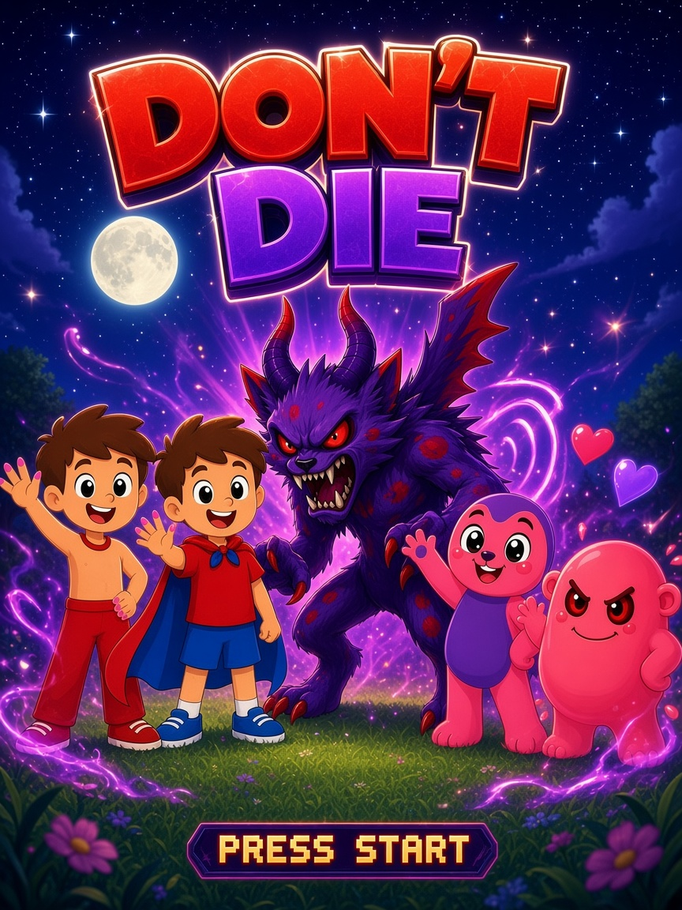

# anitagame

# DON'T DIE

A platformer designed by a kid. The caped kid is the hero.

## How to play

Open `index.html` in a browser. On a phone, turn it sideways and tap to start.

## Controls

**Desktop**

- Run with the arrow keys or A / D
- Jump with Space, Up, or W
- Fly by holding F or Shift (limited by a meter)
- Laser with Z or J
- Talk with X
- Enter starts or restarts
- P pauses
- M toggles sound

**Phone**

On-screen arrow buttons on the left. JUMP, FLY, ZAP, and TALK on the right.

## Gameplay

You have 3 hearts. Find 5 diamonds. Jump on pink blobs, and zap blue blobs with the laser. Collect all 5 diamonds to open the gate to the cat monster boss (16 laser hits). The win screen says "YOU DIDN'T DIE!".
