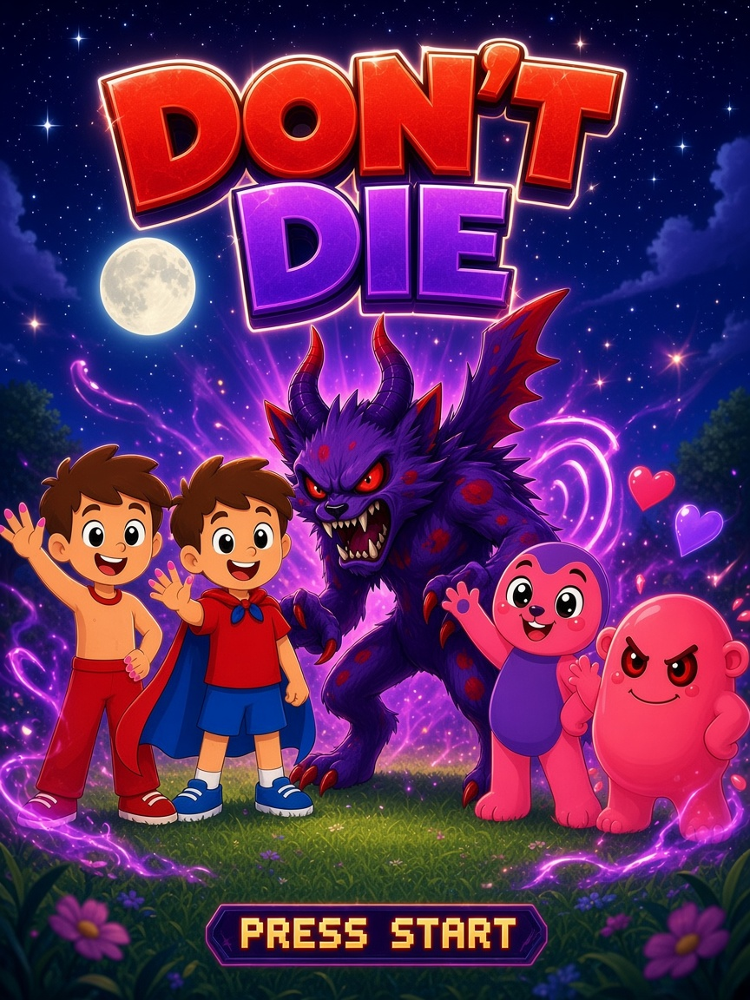

# anitagame

# DON'T DIE

A platformer designed by a kid. The caped kid is the hero.

## How to play

Open `index.html` in a browser. On a phone, turn it sideways and tap to start.

## Controls

**Desktop**

- Run with the arrow keys or A / D
- Jump with Space, Up, or W
- Fly by holding F or Shift (limited by a meter)
- Laser with Z or J
- Talk with X
- Enter starts or restarts
- P pauses
- M toggles sound
- H hides or shows the on-screen buttons

**Phone**

On-screen arrow buttons on the left. JUMP, FLY, ZAP, and TALK on the right. A **Hide buttons** / **Show buttons** control sits in the corner. Tap it to tuck the buttons away, or press H. The choice is remembered on this device.

## Controller

A standard gamepad works alongside the keyboard and the on-screen buttons, including the NVIDIA Shield TV controller.

- Run: left stick (past a small deadzone) or D-pad left/right
- Jump: A, or D-pad up. A also starts or restarts from the title and end screens
- Laser: B or Y
- Talk: X
- Fly: hold RB or RT (the flight meter still limits it)
- Start: start or restart, and pause during play
- Back/Select: hide or show the on-screen buttons
- Sound stays on M, or the on-screen sound button when those buttons are visible

On the title screen, a connected controller changes the prompt to "Press A or START to play". Connecting a controller also hides the on-screen buttons until you touch the screen. If you use Hide buttons / Show buttons, Back, or H, that choice wins and is saved for next time.

## Play on NVIDIA Shield

The browser on Android TV turns the D-pad into a mouse and treats B as Back. The native app sends those buttons to the game instead. It is landscape, fullscreen, and works offline. The download is 1.8 MB (1,837,731 bytes).

1. On the Shield, install the free **Downloader** app by AFTVnews from the Play Store.
2. Allow Downloader to install unknown apps when Android asks (or in Settings, Apps, Downloader, Install unknown apps).
3. In Downloader, enter `https://toranga.github.io/anitagame/DontDie.apk` and download it.
4. Install the APK, then launch **DON'T DIE** from the apps row.

Pair the controller under Settings, Remotes & accessories. Press A or START to play. B fires the laser and does not leave the app. Press Back to pause; press Back again within 2 seconds to quit.

The page at https://toranga.github.io/anitagame/ is the same game in a browser, for a keyboard, a phone, or a computer.

## Gameplay

You have 3 hearts. Find 5 diamonds. Jump on pink blobs, and zap blue blobs with the laser. Collect all 5 diamonds to open the gate to the cat monster boss (16 laser hits). The win screen says "YOU DIDN'T DIE!".
